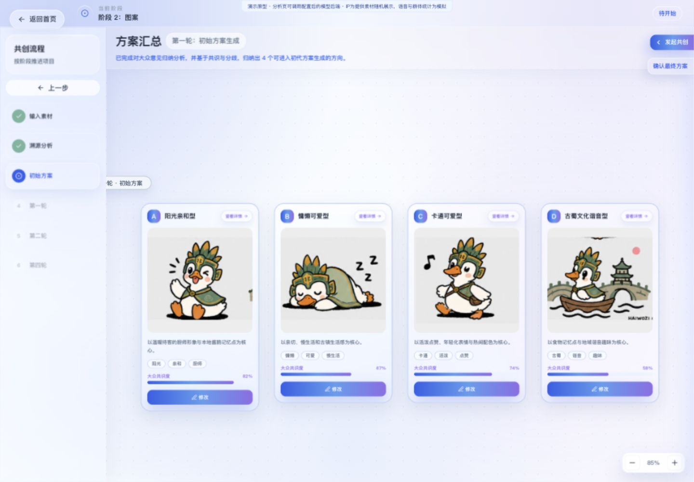

# 乡村公共IP人智协同共创平台

把非专业参与者的生活经验与模糊偏好，转化为可比较、可追溯的设计输入。

**项目定位：用户研究驱动的交互原型。** 面向产品经理、用户研究与交互设计岗位展示问题定义、研究转译、共创机制和原型表达能力。作者背景：同济大学交互设计硕士。个人项目，研究、产品机制、交互视觉与原型实现均由本人完成（作者确认）。

> 当前版本已在React分析页接入Node模型后端，可配置兼容API执行真实分析。未配置密钥时明确报错。候选IP为作者提供的六张形象随机展示，群体票数、语音和原有矩阵仍是模拟；真实推理本次未验证。没有后台投票或跨设备协同。



## 为什么做这个项目

乡村公共IP需要兼顾地方文化、日常生活经验与传播使用场景。村民、商户、手艺人、游客和组织方拥有不同知识与诉求，却不一定能直接说出造型比例、色彩或风格参数。参与者可能知道“像不像本地”“是否亲切”“适不适合门头”，但难以把判断转成专业设计语言。

现有主题编码还提示了另外两类障碍：长文本、复杂操作和额外时间成本会降低参与意愿；单纯投票又无法完整说明选择原因。由此提出的产品问题是：**怎样让参与者用熟悉的表达做判断，让设计者保留判断背后的语境，并看见不同主体间的分歧？**

这些是定性材料中的主题和设计依据，不能据此宣称代表全部乡村人群，也没有证据表明本原型已经提升效率或共识。

## 从研究发现到产品机制

研究依据来自作者提供的主题编码材料。本仓库仅保留去标识的概括，不公开访谈原文、受访者姓名或编码工作簿；材料的访谈执行者与编码分工待作者确认。详细映射见 [研究到设计的对应表](docs/research-to-design.md)。

| 研究主题 | 设计决策 | 当前原型实现与边界 |
| --- | --- | --- |
| 非专业参与者更容易判断方向，难描述专业细节 | 将外观、风格、代表元素拆成引导问题；点选后允许补充理由 | 手机端标签、多选身份、文本输入可操作；语音和润色为模拟 |
| “亲切、可爱、活泼”等偏好需要专业转译 | 用语义输入与参数滑块连接生活语言和设计变量 | “活泼”映射饱和度、暖度等预置参数；未知输入回退默认模板，无语义模型 |
| 选择需要具体参照，也需容纳不同意见 | 并列比较多个候选，展示来源、共识与分歧 | 候选卡片、溯源矩阵和演化连线可查看；图像与百分比为示例 |
| 不同主体的意见不能只用总体平均掩盖 | 保留身份视角，展示分组意见并允许组织方配置权重 | 身份选择、主体权重控件和分组汇总UI已实现；统计不来自真实参与者 |
| 反馈与贡献可见有助于保持关注 | 展示反馈强化/减弱、迭代轨迹与个人贡献摘要 | 本地规则更新标签权重，记录交互历史；不构成真实采纳证明 |

## 核心流程与已实现功能

`项目入口 → 意见维度配置 → 手机端引导表达 → 溯源分析预览 → 初始候选比较 → 局部精调 / 群体反馈轮次 → 最终方案与贡献摘要`

- **项目入口与示例元素库**：查看元素详情、调用示例素材；创建弹窗与文件名展示可操作，但弹窗字段未传入后续项目，文件未被读取或解析。
- **意见征集配置**：修改项目基础信息；解锁维度后编辑、新增、删除、排序，并在同页手机模拟器中预览。
- **参与者表达**：身份与偏好标签、多步问答、可选文字、文件名补充、模拟语音与润色、提交完成状态。提交仅改变页面状态，不收集到服务器。
- **设计转译与比较**：按关键词规则展示意见来源、共识/分歧矩阵与示例素材库；四个初始方向、卡片翻面详情、画布缩放与拖拽。
- **迭代机制**：语义对应预置滑块；局部调整新增同轮节点并保留参数与追踪信息，但不生成新图。独立交互进化页通过喜欢/不确定/不喜欢和标签选择，更新本地权重并切换预置候选。
- **方案收敛**：多轮反馈结果页、最终方案选择、方案摘要及本机交互贡献展示。部分流程依赖 sessionStorage，不代表多人协同。

## 快速运行

已在 macOS、Node.js 22.15.1、npm 10.9.2 下构建与浏览器检查。建议使用 Node.js 22 LTS；package.json 声明最低 Node.js 20，该最低版本未单独测试。

```bash
npm ci
npm run dev -- --host 127.0.0.1
```

打开终端显示的本地地址（默认 `http://127.0.0.1:5173`）。**仅浏览模拟流程无需API密钥或环境变量**；安装依赖需要访问npm仓库。建议桌面端使用宽度1440px左右的浏览器，手机端单独打开 `/mobile-feedback` 或 `/interactive-evolution-demo`。

```bash
npm run build
npm run preview -- --host 127.0.0.1
npm run lint
```

构建产物在 `dist/`。源码使用根路径和 History API；部署需要放在域名根路径并将子路由回退到 `index.html`。直接部署到 GitHub Pages 的仓库子路径尚未适配。**创建GitHub仓库并不会自动获得在线演示。**

状态以页面内存与 `sessionStorage` 为主。刷新会重置部分输入；清空站点会话存储可恢复演示初始状态。邀请链接中的标记不提供身份验证或配置同步。

## 三分钟演示

1. 首页点击“开始创建”，再点击“项目解析”，进入演示配置。
2. 在“采集用户意见维度”中编辑并预览手机问答；点击“确认发布”生成本机链接，再点“查看意见汇总”。汇总使用内置示例意见。
3. 分析完成后点“确认并继续”，查看四个初始方向与翻面的溯源详情。
4. 在方案卡上点“修改”，输入“活泼”，点“生成自适应滑块”；调整参数后“确认生成”，查看新增的同轮方案卡。
5. “发起共创”后选方案、确认选择、生成本地演示链接；通过“模拟完成并查看结果”查看预置群体结果。也可单独访问 `/interactive-evolution-demo` 体验连续评价。

## 我的贡献与AI辅助方式

这是本人独立完成的个人项目：负责用户研究、访谈与主题编码、洞察提炼、产品机制、信息架构、桌面与手机端交互视觉、原型开发。研究与设计过程见 [补充洞察与设计图](docs/design-insights.md)。

开发过程的具体AI工具和使用比例不作推断；本项目重点呈现研究转译和共创机制，不宣称所有代码均逐行手写。本次仓库整理由AI助手辅助完成审查、文档、截图与发布副本必要修正。

## 真实模型工作流 demo 与版本边界

[运行旧版模型demo](demos/model-workflow/README.md)：Node服务端有真实 `/chat/completions` 调用，覆盖文本/图片理解、关联、聚类、分歧、设计转译和Prompt输出；目前已通过Vite代理接到React分析页，独立demo也可单独运行。作者说明旧版NLP使用DeepSeek、图像部分使用千问；目前找到的代码只支持单一兼容接口配置，未找到千问图像生成专用实现，也未重跑真实付费推理。

Dify工作流曾搭建但未跑通，作为系统设计探索展示。服务蓝图与技术路线不等同于全部功能已实现。

## 技术与目录

React 19、TypeScript 5.6、Vite 5、Tailwind CSS 3、Framer Motion、Lucide React、Radix UI（基础控件），使用 npm 锁定依赖。根目录原型除分析后端外无数据库或账号系统；独立demo使用Node内置HTTP与fetch，无第三方模型SDK。

```text
src/
  App.tsx                 路由分发、桌面流程与最终确认
  pages/                  手机问答、分析、多轮反馈、交互进化
  components/             候选卡、画布、参数精调与流程组件
  data/                   明确标记的模拟数据及SVG候选
  services/               本地反馈权重规则；未来API接入位置
  lib/                    会话存储、选择、轮次和分析数据结构
  types/                  业务类型
public/                   页面图标
docs/                    研究映射、实现审计、演示说明与截图
```

## 当前限制与验证状态

- 已接入可配置的大模型分析后端；未接入图像生成、语音识别、文档解析、多人实时协同或通知发送，模型分析本次未执行真实推理。
- 候选图已使用作者提供的六个IP形象，页面加载时随机打乱分配；既有标签与说明暂未逐图匹配，不能用于效果评价。所有票数、共识度和群体均值均为演示值。
- 手机问答提交不进入桌面汇总；独立手机页不继承桌面配置。局部生成沿用原图，候选切换不代表模型学习。
- 部分侧栏轮次名称与页面覆盖标题不一致；桌面工作台不适用于窄手机屏幕。
- 生产构建通过，有单包体积超过500kB的提示。ESLint现存2项画布组件规则错误，未通过；具体见 [运行与实现审计](docs/implementation-audit.md)。
- 未提供系统可用性测试、参与人数、任务成功率、满意度或对照实验数据；不作上线或效果验证声明。

截图与演示入口见 [演示说明](docs/demo.md)。当前已检查工程中没有视频文件或有效在线演示地址，未虚构链接。

## 公开范围与权属

发布候选仅包含前端源码、依赖锁文件、去标识研究概括、文档及从原型实拍的截图。原始访谈、主题编码表、论文、个人资料、依赖目录、构建缓存和密钥均不纳入Git。

**暂不添加开源许可证。** 作者已确认个人独立完成且公开无额外限制。暂不授予额外开源复用许可；第三方依赖仍遵循各自许可。第三方依赖保持其各自许可约束；公开代码不等于授予任意复用权。见 [素材与依赖说明](docs/rights-and-assets.md)。

## 新版后端接入运行方式

已将旧Node工作流接入新版分析页：`ModelAnalysisPanel → Vite /api代理 → Node /api/workflow/analyze → 配置的模型服务`。返回设计简报、生成Prompt、溯源表及素材库，以独立结果区展示；不自动替换下方本地矩阵、不自动生成候选图。

```bash
cp .env.example .env
# 在本机.env填写自己的密钥，禁止提交Git
npm run backend
# 另开终端
npm run dev -- --host 127.0.0.1
```

进入 `/analysis-preview`，编辑“分析文字（每行一条）”，点击“调用后端分析”。DeepSeek文本配置示例见.env.example；需要支持视觉的服务才能分析图片。本次没有增加新的图片上传流程，现有页面通常仍使用示例素材，上传文件名不等于解析文件内容。

模型服务错误会显示在真实分析面板，不以模拟结果冒充成功；原本的规则矩阵独立保留供演示。Key只保存在服务端环境变量，不进入VITE_*或浏览器。生产部署还需要单独运行Node与同源API反向代理；`dist`静态文件本身不提供后端能力。

新版检查：TypeScript与Vite构建通过；浏览器确认新IP资源可加载，真实分析按钮经代理收到后端“模型服务未配置”的400错误。没有真实密钥，因此没有证明端到端真实推理成功。此次更新使用新的演示缓存命名空间以避免旧占位图残留，旧会话数据未被删除。
