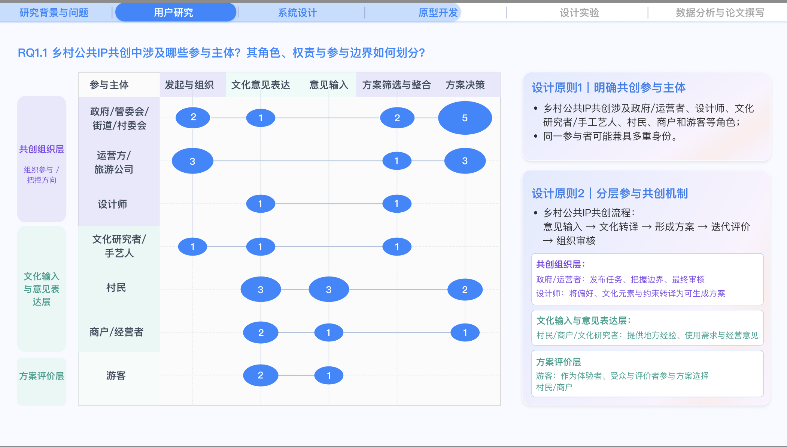
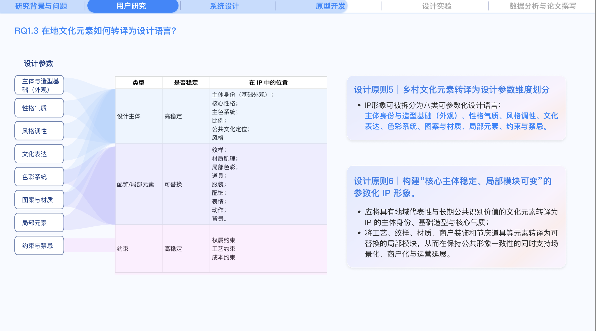
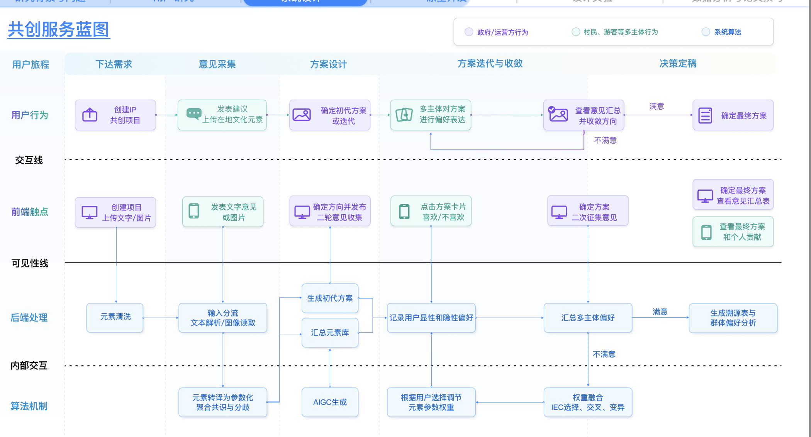
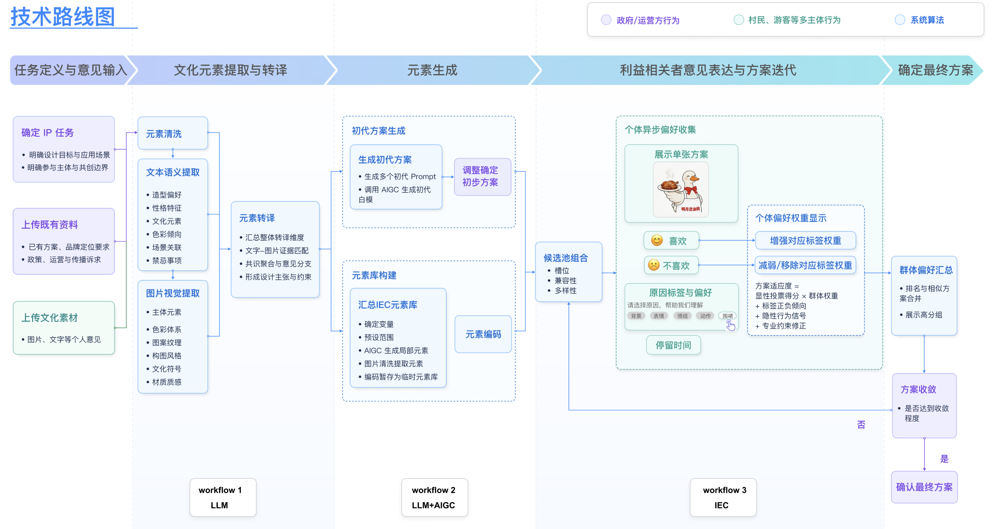

# 主题编码形成的设计洞察与工作流

依据作者本次提供的研究截图整理。作者确认这是个人项目，研究、编码、设计与原型均由本人完成。截图中的数值口径未经额外核验，不作为样本量、统计显著性或产品效果引用。含访谈语义切片、姓名与原始文件路径的截图不收入公开候选；以下仅保留洞察与系统设计图。

## 六项设计原则

1. 明确参与主体：政府/运营方、设计师、文化研究者/手艺人、村民、商户、游客；同一参与者可能具多重身份。
2. 分层参与：组织方发布任务、界定边界并审核；设计者承担专业转译与整合；在地主体提供经验与需求；游客等参与候选评价。群体投票不能代替全部公共决策。
3. 降低表达负担：选择、投票、图片比较、标签和短理由优先，控制时长，尽快呈现反馈。当前问答尚未验证耗时。
4. 让贡献可见：展示意见分布与采纳线索，说明意见如何被解释并进入修改。持续参与效果属于待验证假设。
5. 将文化转译为八类设计语言：主体身份与造型基础、性格气质、风格调性、文化表达、色彩系统、图案与材质、局部元素、约束与禁忌。
6. 保持核心稳定、局部模块可变：主体身份、基础造型和核心气质维持公共识别；纹样、材质、商户装饰、节庆道具等作为可替换模块；权属、工艺与成本约束贯穿迭代。

## 系统设计和实际实现的区别

设计链条为：任务和意见输入 → 文本/图片提取 → 证据匹配与共识/分歧转译 → 初代方案/元素库 → 单卡反馈 → 标签权重及候选迭代 → 群体汇总与组织收敛。

- 根目录交互原型：展示上述交互，分析、生图和群体数据为模拟。
- `demos/model-workflow`：真实模型API代码，已接入新版分析页，执行分析与Prompt输出；本次未重跑真实服务，已接入React分析页。
- Dify：作者确认搭建过但未跑通；截图与本机迁移文档作为设计探索证据，不作为完成部署的证据。
- IEC中的选择、交叉、变异、隐性停留信号和完整群体优化属于技术路线设想；当前交互原型的标签加减权和候选切换不能等同于完整IEC算法。

